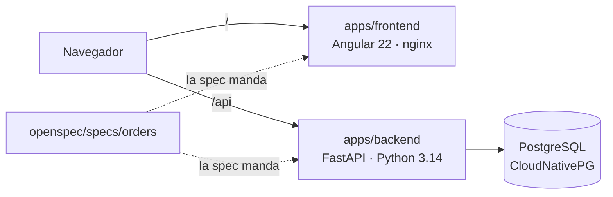
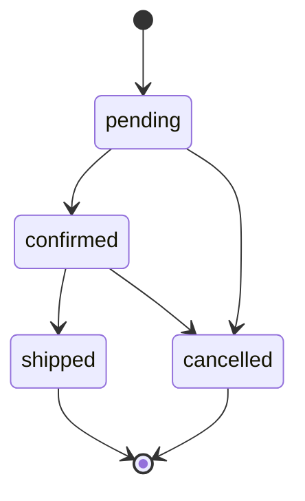
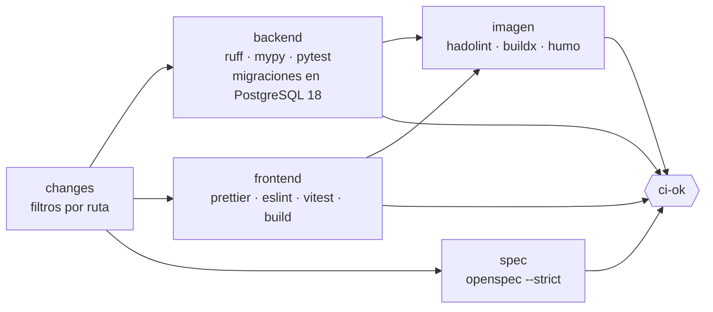

# meridian-orders

> Aplicación de ejemplo del [agentic-platform-lab](https://github.com/elpalmeral-org/agentic-platform-lab):
> un gestor de pedidos **ficticio**, lo bastante realista para reconocerse en él y lo bastante
> pequeño para que un agente lo cambie en una demo.



## Estructura

```
├── apps/
│   ├── backend/      FastAPI · SQLAlchemy 2.1 · Alembic · uv · ruff · mypy (strict) · pytest
│   └── frontend/     Angular 22 (standalone, zoneless, signals) · ESLint · Prettier · Vitest
└── openspec/         Spec-Driven Development: specs vigentes y cambios en curso
```

| | |
|---|---|
| Spec vigente | [`openspec/specs/orders/spec.md`](openspec/specs/orders/spec.md): alta, consulta, ciclo de vida, panel y operabilidad |
| API | `GET/POST /api/orders` · `GET /api/orders/{id}` · `PATCH /api/orders/{id}/status` · `GET /api/info` · docs en `/api/docs` |
| Operación | `/healthz` · `/readyz` · `/metrics` (Prometheus) |
| Ciclo de vida | `pending → confirmed → shipped`; `pending/confirmed → cancelled`; `shipped` y `cancelled` son finales |



## Desarrollo local

Requisitos: [uv](https://docs.astral.sh/uv/) y Node ≥ 24.15.

```bash
# Backend (SQLite local; en el clúster es PostgreSQL)
cd apps/backend
uv sync
export MERIDIAN_DATABASE_URL="sqlite+pysqlite:///./dev.db"
uv run alembic upgrade head
uv run uvicorn meridian_orders.main:app --reload --port 8000

# Frontend (otra terminal): proxy de /api al backend en :8000
cd apps/frontend
npm ci
npm start            # http://localhost:4200
```

## Calidad

```bash
# Backend
cd apps/backend
uv run ruff format --check . && uv run ruff check . && uv run mypy && uv run pytest
uv run alembic check          # el modelo y las migraciones no divergen

# Frontend
cd apps/frontend
npm run format:check && npm run lint && npm run test:ci && npx ng build

# Spec
npx @fission-ai/openspec@1.15.0 validate --specs --strict
```

En cada PR, el workflow [`ci`](.github/workflows/ci.yml) ejecuta solo lo que ha cambiado
(backend, frontend, spec), construye la imagen de cada app modificada con una prueba de humo, y
publica un único check agregado, **`ci-ok`**. El check **`conventional-commits`** valida el título
del PR. Los dos son obligatorios para fusionar en `main`.



## Cómo cambia este repo

Trunk-based: rama corta → PR con título [Conventional Commits](https://www.conventionalcommits.org/es/)
→ *squash merge*. Cada merge en `main` despliega en **dev**; las versiones (`vX.Y.Z`) las crea
release-please y se promocionan a staging y prod por PR en
[`platform-gitops`](https://github.com/elpalmeral-org/platform-gitops).

> **Fuera de alcance a propósito:** la puntuación de riesgo de pedidos. Es la primera feature que
> construirá un agente mediante AIDLC (fase 5 del lab), de la spec al despliegue.
